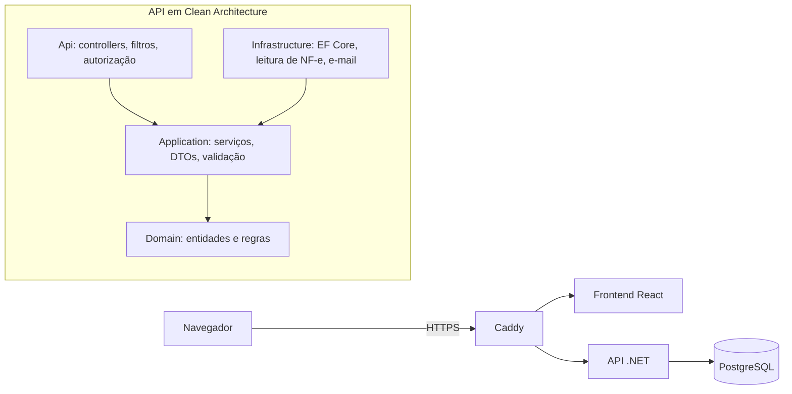

# SisVeículos

**Sistema de gestão para lojas de veículos**, em produção. Controla o estoque do carro à bicicleta elétrica, a transferência entre lojas e a entrada por nota
fiscal. Cada empresa e cada loja enxerga só o que é seu.

> O código-fonte é privado porque o sistema atende clientes reais. Este repositório apresenta o
> projeto; posso mostrar o código numa conversa, com compartilhamento de tela.

<!-- Capturas de tela: coloque os arquivos na pasta imagens/ e descomente as linhas abaixo.
     Use sempre dados fictícios.

-->

## Funcionalidades

- **Estoque de veículos:** carros, motos, bicicletas elétricas e autopropelidos, com campos que mudam
  conforme a espécie. Mostra os dias parados em estoque, o custo e a margem.
- **Importação de NF-e:** lê a nota de compra em XML ou PDF (DANFE), sugere marca, modelo, chassi,
  cor e ano, e cadastra o lote de uma vez. O fornecedor é criado sozinho, e o sistema lembra qual
  modelo corresponde a cada código de produto.
- **Transferência entre lojas:** envio e recebimento com histórico. Pode exigir uma segunda pessoa
  para confirmar o recebimento.
- **Cadastros:** clientes, funcionários, fornecedores, produtos, serviços, marcas e modelos.
- **Vários clientes no mesmo sistema:** cada empresa tem as suas lojas, os seus usuários e o seu plano
  de licença.
- **Perfis de acesso:** permissões por ação, como ver custo, importar nota ou excluir. O administrador
  da empresa monta os perfis.
- **Auditoria:** registra quem alterou o quê e quando, com o valor de antes e o de depois.

## Segurança

- Login com verificação em duas etapas (MFA por aplicativo autenticador).
- Sessão curta com renovação automática e encerramento por inatividade.
- Permissão conferida no servidor em cada requisição, não só escondida na tela.
- Isolamento entre empresas e lojas coberto por testes automatizados.
- Bloqueio de conta após tentativas de login erradas e limite de requisições.
- Testes de invasão periódicos.

## Tecnologias

| Camada         | Tecnologias                                                                       |
| -------------- | --------------------------------------------------------------------------------- |
| Backend        | .NET 10, ASP.NET Core, Clean Architecture, Entity Framework Core, FluentValidation |
| Banco de dados | PostgreSQL 16                                                                     |
| Frontend       | React 18, TypeScript, Vite, TanStack Query, React Hook Form, Zod, Tailwind CSS    |
| Testes         | xUnit, Testcontainers, Vitest, Testing Library, MSW                               |
| Infraestrutura | Docker, Caddy (HTTPS automático), Oracle Cloud                                    |

## Arquitetura

## Qualidade

Cerca de **3.000 testes automatizados**, que rodam antes de cada publicação:

| Suíte                 | Testes | O que cobre                                                     |
| --------------------- | -----: | --------------------------------------------------------------- |
| Unitários (backend)   |    875 | regras de negócio, validações, leitura de notas fiscais         |
| Integração (backend)  |    729 | API completa contra um PostgreSQL real, permissões, isolamento  |
| Frontend              |  1.363 | telas, formulários, permissões na interface                     |

## Autor

**Ricardo Silva Santana**, desenvolvedor Full Stack .NET em Uberaba (MG).
